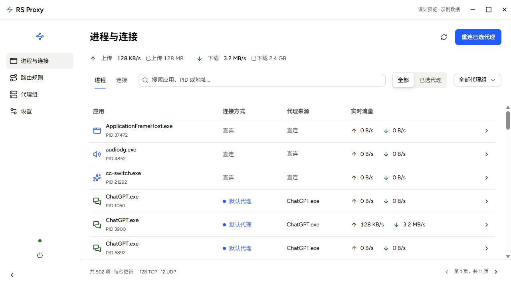
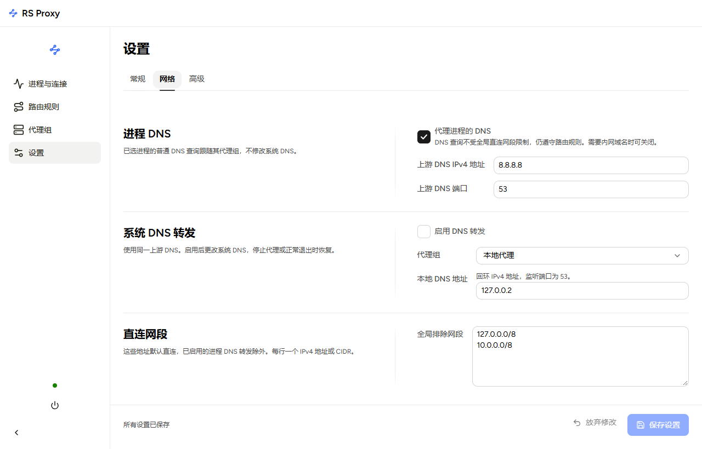

# RS Proxy

**English** | [简体中文](README.zh-CN.md)

**Route Windows applications through SOCKS5, one process at a time.**

Built with Rust and Tauri 2, RS Proxy lets you select an application and its descendants, or use routing rules to forward their IPv4 TCP and UDP traffic through a proxy.


[](LICENSE)

## Preview

Interface previews with example data; details may differ from the current version.



<details>
<summary>Network and DNS settings</summary>



</details>

## Features

- **Per-process routing** — select a proxy for an application and its descendants; manual selections take priority over rules.
- **Flexible rules** — match process names, executable paths, command lines, protocols, destination networks, and ports in order.
- **Live visibility** — inspect connections, upload/download rates, and traffic totals by process and proxy group.
- **DNS options** — forward selected processes' DNS without changing adapter settings, or enable the separate system DNS forwarder with recovery records.
- **Desktop controls** — light/dark themes, tray controls, configuration import/export, and optional elevated startup at sign-in.

## Getting started

Requires **Windows 10/11 x64**, **WebView2 Runtime**, administrator privileges, and a SOCKS5 server with no authentication. WinDivert 2.2.2 runtime resources and licenses are included.

1. Run RS Proxy as administrator. Add a SOCKS5 host and port under **Proxy groups**, then test the connection.
2. Open a process's details and apply a proxy group to it and its descendants.
3. For automatic routing, add rules. Enabled rules match from top to bottom.

Changes apply to **new connections**. Existing TCP connections keep their original route. **Reconnect selected proxies** closes eligible direct TCP connections so applications can establish new ones; it does not terminate processes or reconnect UDP/IPv6 traffic.

Closing the window normally minimizes to the tray. Choose **Exit** from the tray to stop the engine and restore any system DNS settings changed by RS Proxy. System DNS forwarding is disabled by default; Windows system proxy and routing table settings are unchanged.

## Supported traffic

- IPv4 TCP and unfragmented UDP. General UDP forwarding requires SOCKS5 `UDP ASSOCIATE` support; process DNS uses TCP.
- IPv6, ICMP, fragmented IPv4, and unresolved process ownership remain direct. RS Proxy is not a firewall that blocks every direct connection.
- Process DNS handles ordinary queries to non-loopback IPv4 port 53. Shared Windows DNS Client queries, cached answers, and DoH/DoT are outside its scope.
- Protected processes may not expose their executable paths or command lines.

## Build

Use Rust **1.94+** (MSVC), Visual Studio C++ Build Tools and Windows SDK, Node.js **22.13+**, and npm.

```powershell
npm ci
npm run desktop                         # Development
npm run tauri -- build --bundles nsis     # Release program and installer
```

The installer is generated in `target/release/bundle/nsis/`. Portable distributions must keep the adjacent `windivert/` directory and license resources with the executable. `npm run dev` alone previews the frontend without the Windows backend.

## Documentation

- [Build, configuration, DNS recovery, and verification](docs/guide.md)
- [简体中文使用与开发说明](docs/guide.zh-CN.md)
- [Contributor conventions](AGENTS.md) · [Report a bug or request a feature](https://github.com/hicms/rs-proxy/issues)

## License

[MIT](LICENSE). Third-party components retain their own licenses; see [THIRD_PARTY_NOTICES.md](THIRD_PARTY_NOTICES.md).
